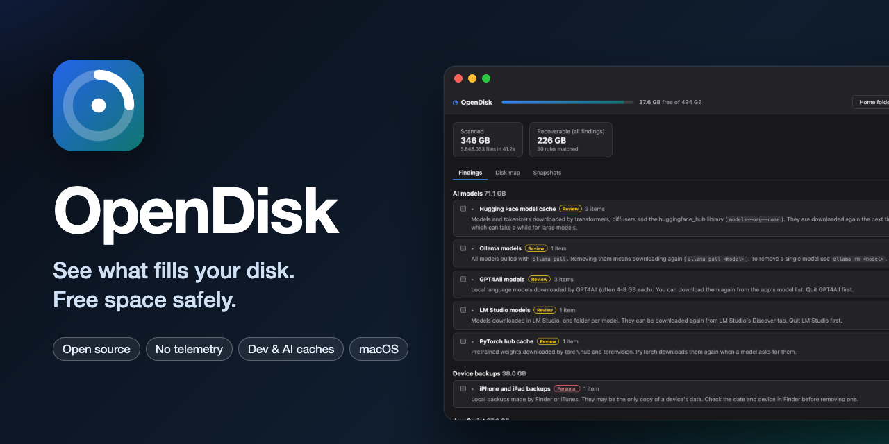

<p align="center">
  
</p>

# OpenDisk

An open source disk cleaner that shows what fills your disk and frees space **safely**. It is built for developers
and AI/ML users first (Xcode and simulators, Docker, npm/Gradle/Cargo caches, Hugging Face and local LLM models) and
stays usable for everyone else. **No telemetry, no accounts, no network access.**

On a Mac most of the space hides in `~/Library` and in dot-folders such as `~/.cache`, `~/.npm` or `~/.gradle`,
which Finder doesn't show. OpenDisk scans them, explains every cache it finds (what it is, whether it comes back on
its own, what must be closed first) and cleans only what you pick, after a preview. Most things go to the Trash.

## Download

A universal **macOS (.dmg)** for Apple silicon and Intel is built by GitHub Actions and attached to each
[release](https://github.com/rldona/OpenDisk/releases); builds of every commit are the `OpenDisk-macos-universal`
artifact of the [CI workflow](https://github.com/rldona/OpenDisk/actions/workflows/ci.yml). They are not yet signed
with an Apple Developer ID, so the first launch shows a system warning; the
[getting started guide](https://rldona.github.io/OpenDisk/guide/getting-started) explains how to open it.

**Linux** ships a `.deb` for Ubuntu 22.04 and later (amd64) and an `.AppImage` for any distribution: install the
package with `sudo apt install ./OpenDisk_*_amd64.deb`, or make the AppImage executable and run it.
**Windows 10 and 11** ship an NSIS installer (`.exe`, per-user, no administrator rights) and, when WiX is available,
an `.msi`. Releases also carry the `opendisk` command line tool for Linux and Windows. Windows builds are not signed
yet, so SmartScreen warns on first launch.

## Manual

**https://rldona.github.io/OpenDisk/** covers installing, Full Disk Access, scanning, findings, cleaning and undo,
APFS snapshots, the safety model, the [list of rules](https://rldona.github.io/OpenDisk/reference/rules) and the
[command line](https://rldona.github.io/OpenDisk/reference/cli).

## Features

- **Scan** your home folder or the whole data volume in parallel, with a **disk map** that includes hidden folders
- **Platform-specific rule sets** (50 or more rules each, 61 on macOS) that recognise reclaimable space and explain it: Xcode DerivedData, device support files, archives and
  simulators; npm, Yarn, pnpm, Bun, Playwright; Gradle, Maven, Android emulators; Cargo, rustup, Go; pip, uv, Poetry,
  conda; Hugging Face, PyTorch, Whisper, Ollama, GPT4All and LM Studio models; Docker Desktop; Homebrew; Slack,
  Discord, Teams, VS Code, Cursor, Spotify, Chrome, Edge, Brave, Arc and Firefox caches; logs; old installers in
  Downloads; iOS backups and firmware; the Trash
- **Findings** grouped by category and sorted by size, each with a plain-language explanation and a safety badge
- **Preview → dry run → clean**, with the **space really freed** measured on the disk afterwards
- **Undo**: everything moved to the Trash is journaled and can be put back
- **Official tools first** when they exist: `xcrun simctl delete unavailable`, `brew cleanup`, `docker system prune`,
  `go clean -modcache`, `pnpm store prune`, `conda clean`
- **APFS local snapshots** listed and explained (why freed space may not show up right away)
- **Full Disk Access** detection with a shortcut to the right System Settings pane
- A **command line tool** (`opendisk scan | findings | clean | undo`) on the same engine; cleaning is a dry run unless
  you pass `--execute`

## How it stays safe

| Safety | Meaning | What OpenDisk does |
| --- | --- | --- |
| regenerable | A cache the tool rebuilds on demand | Trash, or delete if you opt in |
| review | Rebuildable but costly (models, archives) | Trash |
| personal | Your own data (backups, Docker volumes, Trash) | Trash; emptying the Trash needs an extra confirmation |

- **Only what a rule covers** (or what you pick yourself), plus a hard **denylist**: nothing outside your home folder,
  never iCloud Drive, Mail, Messages, Photos libraries, keychains or Apple's app containers
- **Re-checked right before acting**: still matches its rule, not a symlink or below one, same inode and modification
  time as in the preview, owning app not running
- **Never follows symlinks, never crosses volumes**, when scanning or deleting
- **Honest sizes**: allocated blocks, hardlinks counted once

Details in the [safety model](https://rldona.github.io/OpenDisk/guide/safety).

## Quick start (from source)

Requires [Rust](https://rustup.rs) stable, Node.js 22+ and the platform toolchain: Xcode command line tools on macOS,
`libwebkit2gtk-4.1-dev` and the usual Tauri dependencies on Linux, and the MSVC build tools on Windows. The minimum
supported Rust is 1.82.

```bash
cargo test                                  # engine and CLI tests (fixture folders only)
cargo run -p opendisk-cli -- findings       # what the rules find in your home folder
cargo run -p opendisk-cli -- clean          # dry run

cd app && npm ci
npm run tauri dev                           # desktop app with hot reload
npm run demo                                # the UI in a browser with made-up data
```

## How it is built

| Layer | Choice |
| --- | --- |
| Engine | Rust library: parallel scanner, YAML rule engine, cleaner with journal (`core/`) |
| Rules | Declarative YAML embedded in the binary, each tested against its own examples (`core/rules/{macos,linux,windows}.yaml`) |
| Desktop app | [Tauri 2](https://tauri.app) with React + TypeScript (`app/`), commands allowlisted |
| Command line | `opendisk` on the same engine (`cli/`) |
| Scan history | SQLite, local only |
| Manual | [VitePress](https://vitepress.dev) on GitHub Pages (`docs/`) |
| Tests | `cargo test`: rules, scanner and cleaner against temporary folder trees, never your real files |

```
core/src/scan.rs       parallel walk, allocated sizes, hardlinks once, no symlinks, no volume crossing
core/src/rules.rs      rule loading, validation and matching
core/src/findings.rs   expands rules against a home folder, resolves overlaps, sizes matches
core/src/clean.rs      plan → execute → verify, re-checks before every action
core/src/journal.rs    journal and undo
core/src/paths.rs      the hard denylist
cli/                   command line
app/src-tauri/         Tauri commands exposed to the UI
app/src/               React interface
docs/                  user manual
```

## Limitations (MVP)

- macOS, Linux (Ubuntu `.deb` and `.AppImage`) and Windows 10/11 (NSIS/MSI). On Linux and Windows there are no APFS
  snapshots or Full Disk Access; the owning app is detected by process name only, and Windows uses the Recycle Bin
- On Windows, emptying the Recycle Bin is left to File Explorer, `%LOCALAPPDATA%`/`%APPDATA%` are assumed to live under
  the user profile, and the scanner opens each file once to read its allocated size (slower than on macOS)
- Not signed with an Apple Developer ID or an Authenticode certificate yet, and not notarized
- Cleans inside your home folder only; system-level space is left to official tools such as `tmutil`
- The scan history is recorded but "what grew since the last scan" is not shown yet
- The scanner uses a portable directory walk; the faster macOS `getattrlistbulk` path is a TODO

## License

[MIT](LICENSE) © Raúl López
